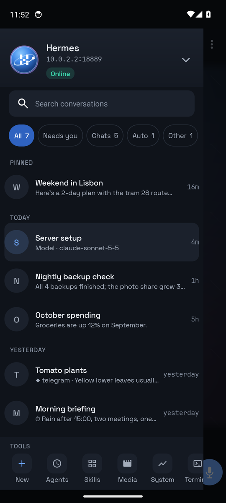
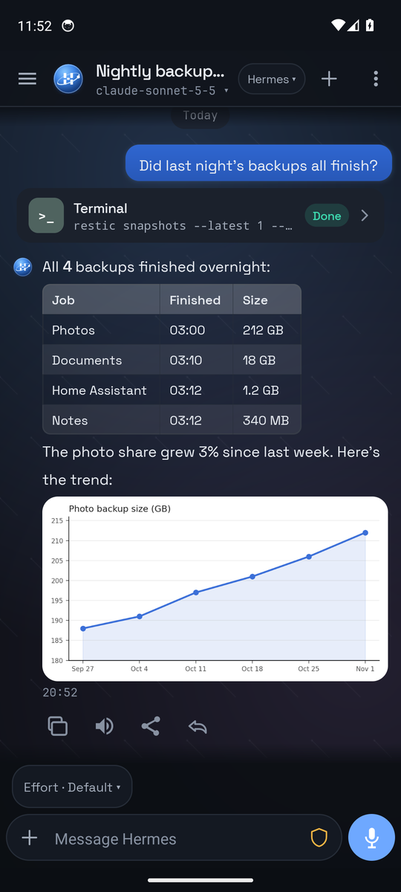
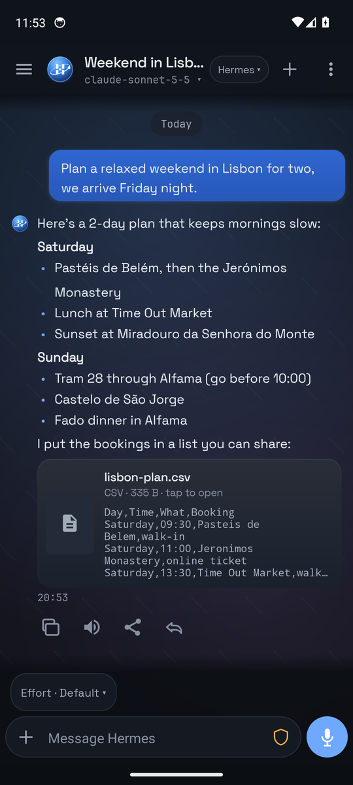
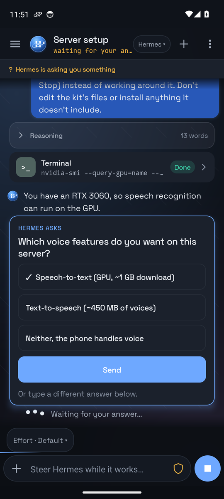
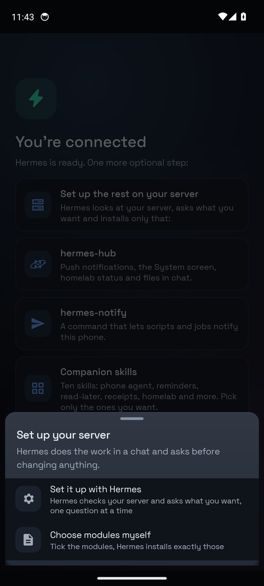
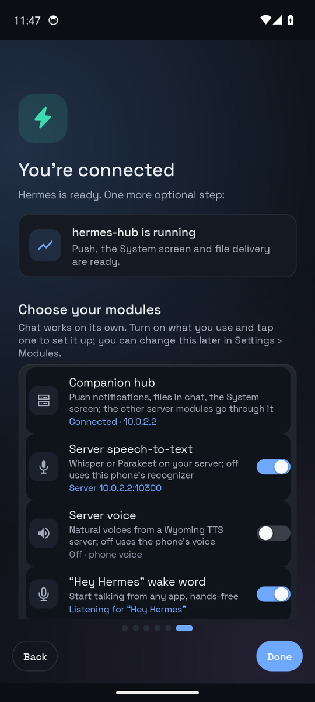

# Hermes Companion for Android

A native, mobile-first front end for a remote [Hermes Agent](https://hermes-agent.nousresearch.com/). It talks directly to the OpenAI-compatible Hermes API server you configure and keeps tool execution on your server.


## Screenshots

<table>
  <tr>
    <td align="center"><br><sub>Conversations</sub></td>
    <td align="center"><br><sub>Tool cards, tables, images</sub></td>
    <td align="center"><br><sub>Files from Hermes</sub></td>
  </tr>
  <tr>
    <td align="center"><br><sub>Hermes asks, you tap</sub></td>
    <td align="center"><br><sub>Guided server setup</sub></td>
    <td align="center"><br><sub>Only the modules you want</sub></td>
  </tr>
</table>

<sub>Demo data on an emulator; no real account.</sub>

## Features

### Conversations

- Direct-to-last-chat launch with a Telegram/Nekogram-style session drawer (search, pinned, previews)
- Create, rename, fork, switch, pin/unpin, archive, mark unread, and delete Hermes sessions; paginated
  history load ("load more" past the first page) and a per-conversation draft that survives switching away
- New conversations take their title from the first message
- Switch between Hermes profiles on a multiplexing gateway (`/p/<name>`, each with its own API key) or
  other servers from the drawer header, Settings › Profile, or `/profile`. Add a profile from the hub's
  `GET /profiles` list with one tap, or enter a server and key manually. Notifications open the profile
  they belong to.
- Model picker backed by the server's authenticated provider catalog, pinned per session
- Tappable tool cards with full terminal command, output, error, exit-code, and generic tool input/result
  inspectors
- Custom graphite settings, menus, switches, confirms, and input sheets with no OEM-styled dialogs
- Adaptive launcher icon (v26 + v33 themed/monochrome), tap-to-retry on failures, transcript export
- Reply-to-message context, copy controls, and server transcript loading

### Background runs and live streaming

- SSE response streaming with live tool/run status and stop/steer controls
- **Runs survive leaving the app.** The Hermes gateway interrupts a run the moment its SSE client
  disconnects, so `RunManager` owns every in-flight run centrally and `RunService` keeps a foreground
  service alive while any run is active — rotating the screen, switching apps, or closing the assistant
  overlay no longer kills the reply. If the socket still drops, the app recovers the run's outcome with
  `GET /v1/runs/{id}` instead of losing it.
- Live streamed reasoning/thinking, interim commentary, and tool-call cards as they happen (toggle with
  **Show reasoning** in Settings)
- Dangerous-command approvals arrive inline as an `approval.request` event and are answered with
  **Allow once / Allow for this session / Deny**, right in the chat or from a notification
- Notifications for a run that finishes while you're away: **Stop** on the ongoing-run notification,
  **Allow once / This session / Deny** on an approval notification, and a **Reply** action with direct
  text input on a finished-reply notification

### Rich replies

- Markdown rendering: headings, lists, quotes, tables, fenced code with a copy button, and inline images
  (``, including `data:` URLs the server returns inline)
- Multi-image attachments (camera or gallery, several photos per message) and text-file attachments —
  the session chat endpoint rejects file parts, so text files are inlined as fenced blocks instead

### Device assistant

- Device actions: a fenced ` ```device ` JSON protocol lets the agent ask the phone to act — timers,
  alarms, showing alarms, calls, texts, email drafts, navigation, map search, opening a URL, web search,
  opening an app, calendar events, playing music, media transport, flashlight, volume, opening a settings
  page, clipboard copy, sharing text, camera, and filing a capture note. Calls, texts and email only
  pre-fill the relevant app — the user always sends. READ queries return requested phone data to Hermes;
  LOCAL actions run on the phone; SENSITIVE actions (calls, messages, sharing and capture) require
  device authentication or a confirmation dialog before they run. The Permission centre's kill switch
  pauses all actions and lookups.
- Phone context (local time and zone, device model, language, battery, network, and optionally
  approximate location) is sent as an ephemeral, per-turn system message, never stored in the transcript
- **Ask Hermes** from the Android text-selection menu and the share sheet (text and images)
- Hands-free conversation mode: after a spoken reply, keep listening for the next prompt
- Can be selected as Android's **Digital assistant app** and invoked by the assistant gesture / hold-power
  shortcut, with the option to keep the assistant's own "Assistant" conversation separate from the last chat

### Capture lane

- Essentials capture inbox: a lane separate from chat sessions, with its own connection, its own token,
  and an "open inbox first" setting
- Home-screen capture widget and quick-settings tiles: **Ask Hermes** and **Capture**
- Share-sheet target that files anything shared from another app straight into the capture inbox

### Hub, agents and everyday tools

- Optional **hermes-hub** connection for event notifications, cross-session message search, document
  uploads and Homelab host/service status, logs and authenticated restart. Hub jobs, briefings, alerts
  and proposals can arrive through **UnifiedPush** with the ntfy distributor; Android JobScheduler
  polls the hub when push is unavailable.
- **Agents** opens scheduled Hermes jobs. Create or edit jobs with schedule presets, run now,
  pause/resume or delete them. The **Needs you** drawer filter collects unread conversations and
  active approval requests; approvals can also arrive as notifications. Hub proposals arrive as events.
- Drawer search searches conversations and, with a hub, messages across sessions. **Recall** asks
  Hermes to search past conversations. **Document** uploads a file to the hub for a chat prompt;
  **Save for later** sends selected text to Hermes to append to its read-later file.
- Composer shortcuts include **Dictate**, **Receipt** (take a photo for a prompt) and **Shopping**
  (ask Hermes to update a Home Assistant shopping list).
- **Home** tiles send configurable commands to Hermes. Optional **Places** detect arrival or departure
  on the phone and run a chosen Home command; place coordinates stay on the device.
- **Status** shows daily usage and a configurable token budget. The **Permission centre** groups
  opt-ins, Android permissions, the action kill switch, risk tiers and an inspectable/exportable
  local activity log.

### Voice

- Voice input and dictation record only when invoked. Speech recognition can run on this phone with
  an optional multilingual Whisper tiny int8 model (Greek and English supported), or through your
  self-hosted Wyoming Whisper server (default: Hermes host, port 10300). Auto uses the downloaded
  model when installed, otherwise the server. Download and delete the model in Settings › Voice;
  the model downloads from the sherpa-onnx GitHub release and is stored in app-private files.
- Set the speech language in Settings › Voice (English by default).
- Optional **Hey Hermes** wake word in Settings › Voice uses on-device sherpa-onnx keyword spotting.
  Its roughly 18 MB model downloads once from GitHub. While enabled, a foreground service listens
  with a persistent notification and a **Turn off** action. If Hermes is the default digital assistant,
  the wake word opens the assistant overlay; otherwise a tap-to-send notification offers the command.
- Spoken replies use a selectable installed TTS engine and adjustable rate; the app prefers a
  non-Google engine when one is installed
- Hands-free conversation mode can listen for the next prompt after a spoken reply

### Reply drafting

- Optional Android NotificationListener access plus a per-app allow-list lets you request a draft
  for a notification. Its text is sent to Hermes only after **Draft reply** is tapped. Review or edit
  the result; nothing is sent through the notification reply action until you tap **Send**.

### Assistant overlay, screen context and shortcuts

- **Assistant overlay** — set Hermes as the phone's *Digital assistant app* and the assist gesture or
  power-button hold opens a card over the current app: live speech recognition with partial transcript,
  streamed reply, tool status, inline approvals, Stop, spoken answers and hands-free follow-ups
  (conversation mode). It uses its own "Assistant" conversation or the last chat (Settings).
  The overlay requires Hermes as the default digital assistant; `HermesRecognitionService` lets Android
  accept it for that role.
- **Screen context** — when Android shares it (Settings › Digital assistant › *Use text from screen* /
  *Use screenshot*), the overlay passes visible screen text and a downscaled screenshot so you can ask
  "what is this?" or "reply to this". A *Use screen* chip turns it off per question.
- **Ask Hermes anywhere** — in the text-selection menu (Explain, Summarise, Translate, Reply, Fix grammar,
  Rewrite) and the share sheet for text and images.
- **App shortcuts** — long-press the icon for *Talk to Hermes*, *New conversation* and *Scheduled jobs*.

### Hermes administration

- **Scheduled jobs** — list, create, edit, pause/resume, run now and delete cron jobs (`/api/jobs`), with
  quick-pick schedules; turn the current composer text into a job from Quick actions.
- **Server status** — readiness, reasons for degraded status, version, platforms, active agents, today's
  metrics, feature flags and a latency test (`/health/detailed`, `/v1/capabilities`).
- **Skills & toolsets** — searchable catalog grouped by category; *Use in chat* primes the composer.

### Slash commands

`/new`, `/sessions`, `/stop`, `/steer`, `/model`, `/fork`, `/rename`, `/pin`, `/archive`, `/delete`,
`/skills`, `/tools`, `/jobs`, `/status`, `/health`, `/voice`, `/export`, `/server`, `/home`, `/next`,
`/settings`, `/assistant`, `/profile`

## Hermes API endpoints used

| Endpoint | Used for |
| --- | --- |
| `GET /v1/capabilities` | Health check, server capabilities |
| `GET /health/detailed` | Detailed server/status view |
| `POST /v1/chat/completions` | Compatibility chat path used while the session UI boots |
| `GET /api/sessions` | Session list (search, pinned, previews, pagination) |
| `POST /api/sessions` | Create session |
| `POST /api/sessions/{id}/fork` | Fork a conversation |
| `PATCH /api/sessions/{id}` | Rename / pin / archive / mark unread |
| `DELETE /api/sessions/{id}` | Delete session |
| `GET /api/sessions/{id}/messages` | Paginated transcript load |
| `POST /api/sessions/{id}/chat/stream` | Streamed replies (SSE): deltas, reasoning, commentary, tool events, approval requests |
| `GET /v1/runs/{id}` | Recover a run's outcome after the stream connection drops |
| `POST /v1/runs/{id}/stop` | Stop the active run |
| `POST /v1/runs/{id}/steer` | Steer the active run |
| `POST /v1/runs/{id}/approval` | Respond to a dangerous-command approval (once/session/always/deny) |
| `GET /api/model/options` | Model picker |
| `POST /api/sessions/{id}/model` | Pin a conversation to a model |
| `GET /v1/skills` | Skills browser |
| `GET /v1/toolsets` | Toolsets browser |
| `GET /api/jobs`, `POST /api/jobs`, `PATCH /api/jobs/{id}`, `DELETE /api/jobs/{id}`, `POST /api/jobs/{id}/pause`\|`resume`\|`run` | Scheduled (cron) jobs |
| `POST /v1/artifacts/upload` | Photo/file attachment upload |

## Build

Set `ANDROID_HOME` to your Android SDK path, then:

```bash
./gradlew test assembleDebug
```

APK: `app/build/outputs/apk/debug/app-debug.apk`

## First run

The app ships with **no preconfigured server**. On first launch you set up your
own connection:

1. Open the app and go to **Settings → Hermes server**.
2. Enter the URL of your Hermes API server in **Server URL**. The field is empty
   until you fill it in.
   - Prefer a secure URL, e.g. `https://hermes.example.com`.
   - On a trusted LAN or Tailscale network a plain address such as
     `http://192.168.1.50:8889` also works. The app permits cleartext `http://`
     so you can reach explicit LAN/Tailscale endpoints, but HTTPS (or Tailscale)
     is strongly recommended whenever the traffic leaves your home network.
   - A bare host name such as `hermes.example.com` is treated as `http://hermes.example.com`.
3. Enter the API bearer key in **API key**.
4. Tap **Test connection**, then **Save connection**.

The API key is encrypted with Android Keystore before it is stored on the device.

To use the system shortcut, tap **Set as default assistant** and choose Hermes.
Add **Ask Hermes** from Android's Quick Settings tile editor if wanted.

### ADB provisioning

For devices where typing the key is awkward, `ProvisionActivity` accepts one
explicit ADB launch. It stores the settings **only when both an `endpoint` and a
`key` are supplied**, then disables its own exported component. There is no
fallback to any bundled server address.

```bash
adb shell am start \
  -n com.stormlabs.hermescompanion/cloud.stormlabs.hermescompanion.ProvisionActivity \
  --es endpoint 'https://hermes.example.com' \
  --es key 'YOUR_API_KEY'
```

`session` is an optional extra.

## Secure connection guidance

- **Tailscale**: connect the phone and the server to the same tailnet and use the
  server's Tailscale address (`http://100.x.y.z:8889` or your Tailscale HTTPS
  name). No port forwarding is required.
- **HTTPS**: if the server is reachable over the public internet, put it behind
  HTTPS (reverse proxy or provider TLS). This protects the API key and your
  prompts in transit.
- Cleartext `http://` is supported only for explicit LAN/Tailscale endpoints you
  type yourself; avoid it over untrusted networks.

## Claude Code bridge (text-only preview)

Choose **Claude Code** under Settings → Server type, then enter your self-hosted bridge URL and token. The bridge supports text chat, saved conversations, and Stop. Tools, approvals, images, jobs, model selection, fork, and delete are not yet supported. It is not the Anthropic API URL. See [bridge setup](bridge/README.md).

## Release signing

Release builds are unsigned by default and can be built as-is. To produce a
signed release, provide all four variables in the environment when building:

| Variable | Meaning |
| --- | --- |
| `HERMES_COMPANION_KEYSTORE` | Path to the release keystore file |
| `HERMES_COMPANION_STORE_PASSWORD` | Keystore password |
| `HERMES_COMPANION_KEY_ALIAS` | Key alias |
| `HERMES_COMPANION_KEY_PASSWORD` | Key password |

```bash
export HERMES_COMPANION_KEYSTORE=/path/to/release.keystore
export HERMES_COMPANION_STORE_PASSWORD=...
export HERMES_COMPANION_KEY_ALIAS=...
export HERMES_COMPANION_KEY_PASSWORD=...
./gradlew assembleRelease
```

If any variable is missing, the release build is produced unsigned.

## Privacy

Hermes Companion connects directly to the server you configure, encrypts your API
key locally with Android Keystore, keeps app preferences and its local history cache
on-device, and contains no Stormlabs telemetry. Conversation sessions remain on the
Hermes server you chose. See [PRIVACY.md](PRIVACY.md).

## License

[MIT](LICENSE) © Hermes Companion contributors.
